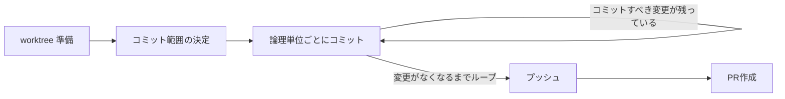

# github-flow

GitHub Flow + Conventional Commits に従い、worktree作成・コミット・プッシュ・プルリクエスト作成までを完結させる Claude Code スキル。

## できること



- リポジトリ直下の `.worktrees/` に作業用worktreeを作成し、main/master を汚さずに作業する
- ステージング状態と会話の文脈から、意味のある論理単位ごとにコミットを分割する
- Conventional Commits 形式（`<type>(<scope>): <description>`）でコミットメッセージを作成する
- `gh` CLI でプルリクエストを作成する（`.github/pull_request_template.md` があれば利用）

詳細な手順は [`skills/github-flow/SKILL.md`](skills/github-flow/SKILL.md) を参照。

## 発動する場面

- 作業完了時: 「コミットして」「PRを作って」「ブランチ切ってPR」「変更をまとめてPR」など
- 作業開始時: 「作業を開始して」「ブランチ切って作業」「worktreeで作業」など

対象外（このスキルではなく他のスキル・素の操作を使う場面）: git stash単体操作、rebase、diff/log閲覧のみ、コンフリクト解決、CI/テスト失敗の調査、ブランチ削除のみ、既存PRのレビュー。

## 必要なもの

- git
- gh CLI（GitHub CLI、認証済みであること）

## インストール

### プラグインとして（推奨: 更新の追従がしやすい）

```
/plugin marketplace add mostlyfine/github-flow
/plugin install github-flow
```

### プラグイン化せずスキルだけ使う場合

`skills/github-flow/` フォルダをそのまま以下のいずれかにコピーする。`plugin.json` や marketplace 登録は不要。

- プロジェクト単位: `<repo>/.claude/skills/github-flow/`
- ユーザー単位（全プロジェクトで使う）: `~/.claude/skills/github-flow/`

## 構成

```
.claude-plugin/
  plugin.json        # プラグインマニフェスト
  marketplace.json    # マーケットプレイス定義
skills/github-flow/
  SKILL.md            # スキル本体
  references/          # ブランチ戦略・コミット規約・PRワークフローなどの詳細
```
